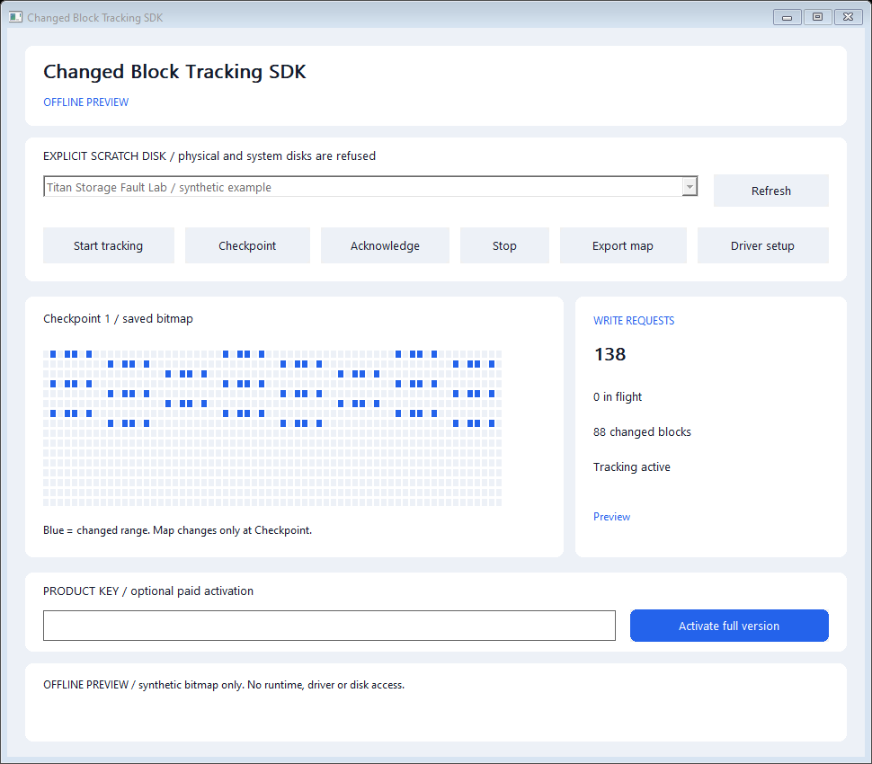

# Changed Block Tracking SDK - Windows Kernel Storage Filter

**Track conservative changed disk ranges and consume immutable checkpoints from C++.**

A native Windows application, a compact C++ SDK and a private KMDF upper disk
filter for incremental-storage integrations. The filter observes write ranges;
the application can freeze a bitmap, consume it while new writes continue, and
acknowledge that exact generation when finished.



**Initial evaluation scope:** Windows 10 version 2004/build 19041+ or Windows 11,
x64 only, explicitly attached to the owned,
unpartitioned **64 MiB Titan Storage Fault Lab synthetic scratch disk**. Physical,
system and other virtual disks are inventory-only. This version does not include
disk imaging, automatic baselines, VSS coordination or production backup support.
See [validation and data guarantees](docs/VALIDATION.md) before integrating it.

The release ZIP contains the application, CLI, example, both single-file setup
executables and matching opaque Microsoft-signed packages under `Driver/`.
Microsoft signing covers the driver packages; the user-mode EXEs are separate.
The supported scope and executed qualification are documented in
[validation](docs/VALIDATION.md).

## Install and try

1. Download the complete bundle from [Releases](https://github.com/titanfyre/Changed-Block-Tracking-SDK/releases). `ChangedBlocksStudio.exe --preview` shows an explicitly synthetic bitmap without opening a runtime or disk.
2. For live evaluation, use a disposable VM with the [Microsoft-signed **Titan Storage Fault Lab** fixture](https://github.com/titanfyre/Virtual-Storage-Fault-Lab/releases). Do not initialize or partition that scratch disk. Save a VM checkpoint first.
3. Run the matching **Microsoft-signed** `ChangedBlocksSetup.exe` as administrator and choose **Install package**. Setup installs the SDK application, CBT package and shared runtime; it does not attach any disk automatically. A source build without both trusted signed packages refuses installation.
4. Select the **owned synthetic scratch disk**, choose **Attach selected**, and restart Windows if requested. Setup preserves other per-device filters and never installs a class-wide filter or restarts Windows automatically.
5. Open **Changed Block Tracking Studio**, refresh, select the attached scratch disk and choose **Start tracking** after establishing your baseline externally. Generate your own test workload. This viewer never writes disk contents.
6. Choose **Checkpoint** to freeze the map. Blue cells represent changed 64 KiB ranges. Export or consume the map, then choose **Acknowledge**. Writes continue into the next bitmap while a checkpoint is frozen.
7. **Stop** closes the tracking owner and discards history. Uninstall first removes this filter's associations; restart when requested, then run Uninstall again to remove its unused package and application. The shared runtime and scratch-disk contents are retained.

Keep the downloaded setup executable. The application's **Driver setup** button
opens it beside the app, or asks you to select it if the installed app is in
Program Files. Merely installing a service package does not attach a disk.

```powershell
ChangedBlocksCLI.exe --disks
ChangedBlocksCLI.exe --devices
ChangedBlocksCLI.exe --track DEVICE_ID
ChangedBlocksSetupConsole.exe /install
ChangedBlocksSetupConsole.exe /attach "exact DiskDrive instance ID"
ChangedBlocksSetupConsole.exe /detach "exact DiskDrive instance ID"
ChangedBlocksSetupConsole.exe /uninstall
```

Console setup returns `3010` when a restart is required. It never restarts
automatically. A selected disk's opaque ID is valid only while that device is
present; obtain it from `--devices`, rather than hard-coding it.

## Minimal C++ integration

Compile `SDK/ChangedBlocks.cpp`, `SDK/Inventory.cpp` and `SDK/License.cpp` with
C++17; link `setupapi`, `cfgmgr32`, `winhttp`, `crypt32` and `advapi32`. Include the
matching headers. Run the integration elevated, as the control device permits
administrators and SYSTEM only.
Manual builds use `UNICODE`, `_UNICODE`, `WIN32_LEAN_AND_MEAN`, `NOMINMAX` and
`_WIN32_WINNT=0x0A00`, matching the included CMake configuration.

When combining Titan SDKs in one app, compile one copy of the shared `License.cpp`.
For Remote Workstation and USB-over-IP together, also compile only one shared `Transport.cpp`.

```cpp
#include "ChangedBlocks.h"

ChangedBlocks::Tracker tracker;
auto devices = tracker.Devices();
// Choose an attached, qualified disk; establish its baseline externally first.
tracker.Start(devices.at(0).id, 64ull * 1024 * 1024);

// Generate a workload, then freeze an interval.
auto changes = tracker.Checkpoint();
changes.ForEachRange([](const ChangedBlocks::Range& range) {
    // Consume [range.offset, range.offset + range.length) from a
    // separately coordinated, consistent storage snapshot.
    return true;
});
tracker.Acknowledge(changes.state.generation); // Only after consumption succeeds.
```

Driver operations throw a detailed English `std::exception` on failure. Catch it
at your application boundary; the [complete example](Examples/track.cpp) does so.
`Verification(key)` returns an English error string, empty on success.

| Function | Purpose |
| --- | --- |
| `Disks()` | Read-only Windows disk identity, eligibility and association inventory. |
| `tracker.Devices()` | Enumerate driver-issued opaque IDs and matching PDO names. |
| `tracker.Start(id, capacity)` | Begin an explicit tracking interval on the exact qualified attached disk. |
| `tracker.Status()` | Inspect current session, writes, in-flight requests and invalid/expired state. |
| `tracker.Checkpoint()` | Return the existing immutable frozen generation, or freeze a new one. |
| `snapshot.ForEachRange(visitor)` | Stream adjacent changed blocks as coalesced byte ranges without expanding a large range array. |
| `tracker.Acknowledge(generation)` | Release only the exact frozen generation, after successful consumption. |
| `tracker.Stop()` | Close this owner and invalidate its history; disk traffic continues unchanged. |
| `tracker.Verification(key)` | Activate full access to this product for the current Windows boot. |

The driver allows one control owner. A tracker serializes its calls. Device
enumeration releases a temporary control handle when it is not tracking, so an
idle inventory view does not keep ownership. Scope exit closes the owner.

## What a checkpoint means

- Granularity is **64 KiB**. A partial write marks the whole overlapping block. The final disk block is clipped to capacity.
- A requested write is marked before forwarding. Failed or partial writes can produce conservative false positives; they do not justify omitting that block.
- A new checkpoint is temporarily refused while a write or other potentially mutating request remains pending. Finish or briefly quiesce that workload and retry; the SDK returns a detailed English busy error and retains tracking. Requests already pending before Start, or across Stop/Start, remain accounted for when they complete on the current baseline.
- A frozen bitmap remains unchanged while tracking continues in a separate map. Consume it successfully before acknowledging; acknowledgment is not automatic after export or read failure.
- Generations increase across intervals and owners. A stale acknowledgment or map read cannot apply to a replacement baseline that happens to reuse a small generation number.
- A checkpoint is a map, not a storage snapshot or a file-content read barrier. Your backup integration must coordinate its own baseline, storage snapshot, consistency and error recovery.
- An unclassified potentially mutating path, unsupported storage bypass, device removal, owner loss or demo expiry invalidates history. **Never interpret invalid history as an empty change list. Establish a new baseline.** Activation cannot recover missing changes.

The protocol bounds capacity at 1 TiB, uses at most 4 MiB for two kernel bitmaps,
and transfers bitmap pages of at most 16 KiB. The supplied evaluation's strict
64 MiB fixture guard is narrower than that protocol bound. No universal storage
compatibility or zero-overhead claim is made.

## Demo, full access and commercial use

The shared resident runtime grants a **one-hour elapsed-time demo per product per
Windows boot**, shared by all processes. Restarting the app or changing the
Windows date does not reset it. At expiry, tracking becomes invalid and disk I/O
continues to pass through. The driver does not disable a disk.

For an evaluation key, commercial/OEM licensing or qualification of a particular
storage stack, add **`titancsa` on Discord** and name **Changed Block Tracking SDK**.

```cpp
auto error = tracker.Verification("YOUR-PRODUCT-KEY");
if (!error.empty()) { /* Show this detailed English error. */ }
```

The same installed driver becomes full for the current boot after accepting a
fresh product-bound proof signed by the licensing server. The private signing
key stays on the server. Call Verification again after reboot. Disabling a key
refuses future activations; previously accepted boot rights remain. Keys are not
machine-bound, and this application does not save them. There is no claim of
unbreakable licensing against a compromised kernel or arbitrary third-party
software.

## Build

Use Visual Studio 2022 Desktop C++, the Windows SDK and CMake on x64:

```powershell
.\Build.ps1
.\Build.ps1 -Asan
# Rebuild setup with both opaque signed packages from the release ZIP:
.\Build.ps1 -RuntimePackageDirectory .\Driver\TitanSdkRuntime `
            -DriverPackageDirectory .\Driver\TitanChangedBlockTracking
```

Outputs are in `obj/Build/bin/Release`. Normal and AddressSanitizer offline tests
open no driver, attach no filter and write no raw disk. Driver implementation,
private validation fixtures and signing credentials are excluded from this repo.

Public application, SDK, example and installer source is [MIT licensed](LICENSE).
Private driver/runtime binaries have separate evaluation and commercial terms.
Use only on systems and disposable data you own or administer with permission.
You are responsible for lawful use, backups and integration correctness. Software
is provided without warranty; mandatory statutory rights remain unaffected. No
unlawful or unauthorized use is endorsed.
